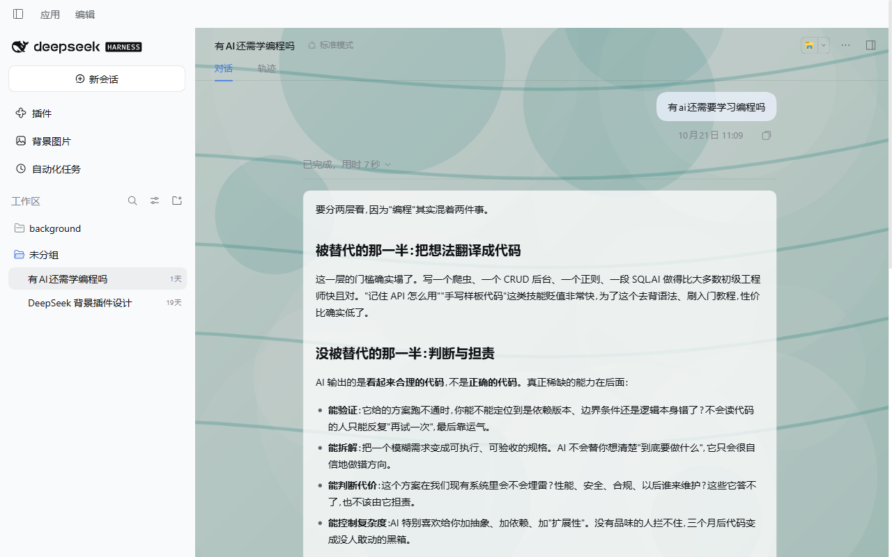
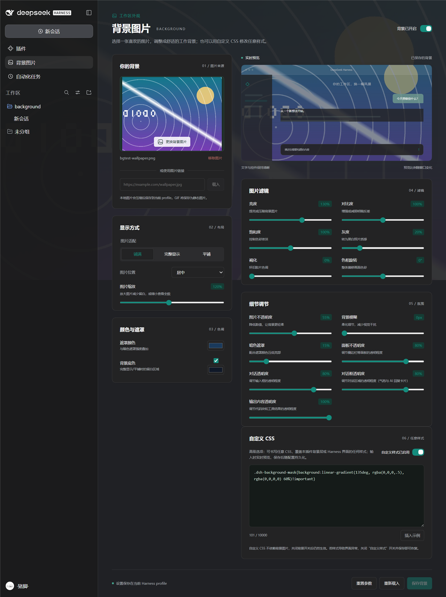

# DeepSeek Harness 背景图片插件

为 DeepSeek Harness 添加自定义背景图片，支持本地导入、HTTPS 图片链接和实时预览，提供中文界面与中文源码注释。

从左侧「背景图片」进入，也可以在「设置 → 通用」点击「设置背景」。




## 功能与兼容性


* 点击或拖入 PNG、JPEG、WebP、AVIF、GIF 图片，也可载入 HTTPS 图片直链。

* 调节图片不透明度、背景模糊、暗色遮罩、面板不透明度和对话透明度。

* 支持铺满、完整显示、平铺，以及居中、顶部、底部、左侧、右侧对齐。

* 当前窗口实时预览，点击「保存背景」后持久化，离开设置页会放弃未保存的预览。

* 面板不透明度调节侧边栏等面板；对话透明度单独调节消息气泡和输入框。

* 跟随 Harness 明暗主题，关闭背景或卸载插件后恢复原样式。

已验证版本为 **DeepSeek Harness 0.2.1-rc.2**；包中声明的兼容范围是 `>=0.2.1-rc.2 <0.3.0`，其他版本尚未逐一验证。本地构建需要 Node.js 22 或更新版本及 npm。

## 从 GitHub 安装

仓库：[ProkyHoof/plug-in](https://github.com/ProkyHoof/plug-in)。插件位于 `deepseek/background` 子目录，包名为 `dsh-background-image`。

**以下命令在插件文件提交并推送至 GitHub 后可用。** 需要将本目录的 `lib/` 构建产物一并推送；安装参数必须包含 `#path:/deepseek/background`，用于选择仓库中的插件目录。

### 桌面版

先启动过桌面版，再使用 **桌面程序自带的 CLI** 安装到 `desktop` profile：


```
dsh plugin --profile desktop add "github:ProkyHoof/plug-in#path:/deepseek/background"
```

这里的 `dsh` 应指向桌面版 CLI。如果命令不可用，或使用 npm 版 CLI 时提示 `desktop` 是保留 profile，可以直接调用桌面安装目录中的入口。Windows 示例，执行前替换安装路径：


```
$dshCli = 'C:\实际安装目录\Deepseek\resources\runtime\cli\bin\dsh.cmd'
& $dshCli plugin --profile desktop add "github:ProkyHoof/plug-in#path:/deepseek/background"
```

安装完成后，完全退出并重新打开 DeepSeek Harness。

### Web 版


```
npx @deepseek-ai/dsh plugin --profile web add "github:ProkyHoof/plug-in#path:/deepseek/background"
```

安装后重新启动 Web 服务并刷新页面。使用自定义 profile 时，将 `web` 替换为实际名称。

Harness 的 `plugin` 命令将安装参数转交给 pnpm，子目录语法见 [pnpm 官方说明](https://pnpm.io/package-sources#install-from-a-subdirectory-of-a-git-repository)；profile 与 bundle 机制见 [Harness 官方说明](https://github.com/deepseek-ai/deepseek-harness/blob/master/docs/user/develop/basic/publish.md)。

## 下载源码后打包安装

如果当前 CLI 不支持 Git 子目录参数，或者需要修改源码，可以先克隆仓库、构建并打包：


```
git clone https://github.com/ProkyHoof/plug-in.git
Set-Location plug-in/deepseek/background
npm ci
npm run check
npm pack
```

版本 `1.0.0` 会生成 `dsh-background-image-1.0.0.tgz`。在上述插件目录中取得包的绝对路径，再选择对应平台安装：


```
$pluginPackage = (Resolve-Path './dsh-background-image-1.0.0.tgz').Path

# 桌面版：使用桌面程序自带的 dsh，或前文的 & $dshCli 调用方式。
dsh plugin --profile desktop add "$pluginPackage"

# Web 版：与桌面版二选一，安装到实际使用的 profile。
npx @deepseek-ai/dsh plugin --profile web add "$pluginPackage"
```

也可以在 GitHub 页面选择「Code → Download ZIP」，解压后进入 `deepseek/background`，从 `npm ci` 开始执行。升级插件版本后，请使用实际生成的 `.tgz` 文件名。

## 使用方法


1. 打开「背景图片」，点击上传区域或拖入图片；使用链接时，粘贴 HTTPS 图片直链并点击「载入」。

2. 选择显示方式和图片位置，调节五个滑块，观察当前窗口中的效果。

3. 点击「保存背景」。设置写入当前 profile，重启后自动恢复。

4. 暂时关闭背景时，关闭右上角开关并保存；移除图片后也需要保存。

5. 「重置参数」保留图片并恢复默认显示参数；「重新载入」放弃当前预览，读取已保存设置。

初次安装默认关闭背景，导入图片后自动开启预览。离开设置页前请保存需要保留的修改。多个窗口同时修改时会检查配置修订号；发生冲突后，点击「重新载入」再编辑。




## 更新与卸载

从 GitHub 安装的用户，更新时重新执行同一条 `add` 命令，获取默认分支的新内容：


```
# 桌面版，使用桌面 CLI。
dsh plugin --profile desktop add "github:ProkyHoof/plug-in#path:/deepseek/background"

# Web 版。
npx @deepseek-ai/dsh plugin --profile web add "github:ProkyHoof/plug-in#path:/deepseek/background"
```

本地打包安装的用户，先更新源码、重新构建打包，再安装新包。更新完成后重新启动 Harness。

卸载时使用**包名**：


```
# 桌面版，使用桌面 CLI。
dsh plugin --profile desktop remove dsh-background-image

# Web 版。
npx @deepseek-ai/dsh plugin --profile web remove dsh-background-image
```

根据使用的平台执行对应命令，再重新启动 Harness。卸载会移除插件依赖及 bundle 注册，已保存的背景配置会保留。仅需恢复默认外观时，可以关闭背景开关并保存。

## 图片与存储

本地原图最大 **20 MB**。导入时将最长边缩放至不超过 **2560 像素**，压缩为不超过 **360 KB** 的静态图片；GIF 也会保存为静态图片。

本地导入的图片数据保存在当前 profile 的 `cordis.patch.yml`，不依赖原文件路径，也不上传到图床。备份或分享该配置文件时，其中也包含背景图片数据。

HTTPS 图片由显示界面的浏览器或桌面窗口加载，链接需要持续可访问。插件调整背景层及部分面板填充色，正文和按钮的透明度保持原有设置。

## 开发与目录


```
background/
├── src/                   # 插件源码，使用中文注释
│   ├── index.js           # Host 配置与持久化声明
│   ├── client.jsx         # 插槽注册、主题与配置订阅
│   ├── App.jsx            # 中文设置界面与预览
│   ├── config.js          # 参数校验与背景样式
│   ├── image-import.js    # 图片解码、缩放、压缩与链接检查
│   ├── renderer.js        # 背景渲染与原样式恢复
│   └── controller.js      # 预览、保存、冲突和错误处理
├── scripts/build.mjs      # Host / Client 构建与 ModuleLoader 封装
├── tests/                 # 逻辑、生命周期与打包客户端测试
├── lib/                   # 构建产物，需要提交到 GitHub
├── docs/                  # 效果截图
├── cordis.patch.yml       # 插件 bundle
├── package.json           # 包元数据、依赖与兼容范围
└── VALIDATION.md           # 验证记录
```


```
npm ci
npm run build   # 构建 lib/
npm run check   # 重新构建并运行测试
npm pack        # 构建并生成可分发的 .tgz 包
```

修改后提交源码、锁文件及 `lib/`，再推送至 GitHub。`node_modules/`、`.reference/` 和 `*.tgz` 已忽略；打包文件可以单独作为 GitHub Release 附件分发。

配置项编号固定为 `background-image`，修改代码时请保留。验证范围见 [VALIDATION.md](VALIDATION.md)，许可证为 [MIT](LICENSE)。